

 

 ## **The Android app and web platform live in separate branches — select one below to get started.**

 

  

ComplyVision reads product labels with **OCR and computer vision**, validates them against  
**Legal Metrology, FSSAI, and BIS**, then uses **Gemini AI** to double-check and explain the result.

 

`OCR` &nbsp;•&nbsp; `Computer Vision` &nbsp;•&nbsp; `Rule Engine` &nbsp;•&nbsp; `Gemini AI` &nbsp;•&nbsp; `Indian Compliance`

---

## The problem

Every packet on a shelf must carry the right information: net quantity, MRP, manufacture and expiry dates, licence
numbers, ingredients, warnings. The rules come from several authorities, differ by product category, and the print is
tiny. Inspectors check by eye, businesses find out about mistakes after a product has shipped, and shoppers have no
easy way to know what an ingredient list really means.

## The idea

Point a camera at the pack. ComplyVision reads the label, works out what kind of product it is, applies only the
rules that product has to meet, and shows every finding with the **exact piece of the label that proves it**. One
engine, three audiences:

- **Consumers** get a plain-language explanation of what they are buying.
- **Inspectors** get a fast, consistent, evidence-backed field tool.
- **Businesses** get to pre-verify against FSSAI and BIS requirements before they submit or launch.

---

## The app

<table>
  <tr>
    <td align="center">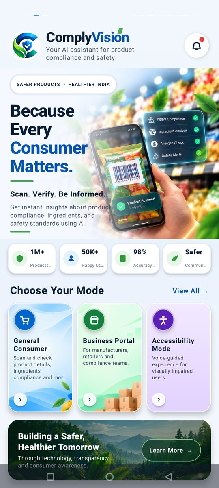 <b>Choose your mode</b></td>
    <td align="center">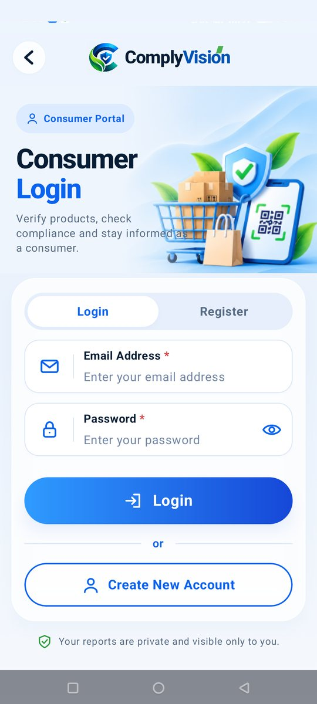 <b>Consumer portal</b></td>
    <td align="center">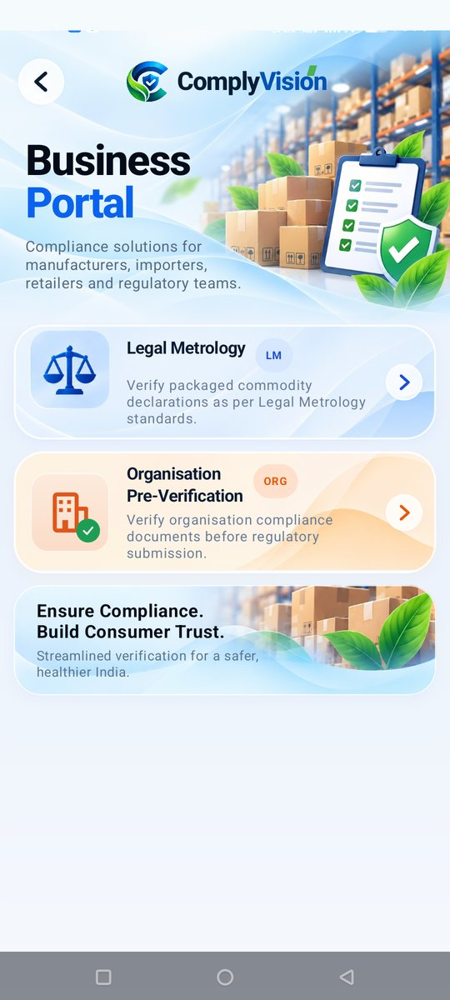 <b>Business portal</b></td>
    <td align="center">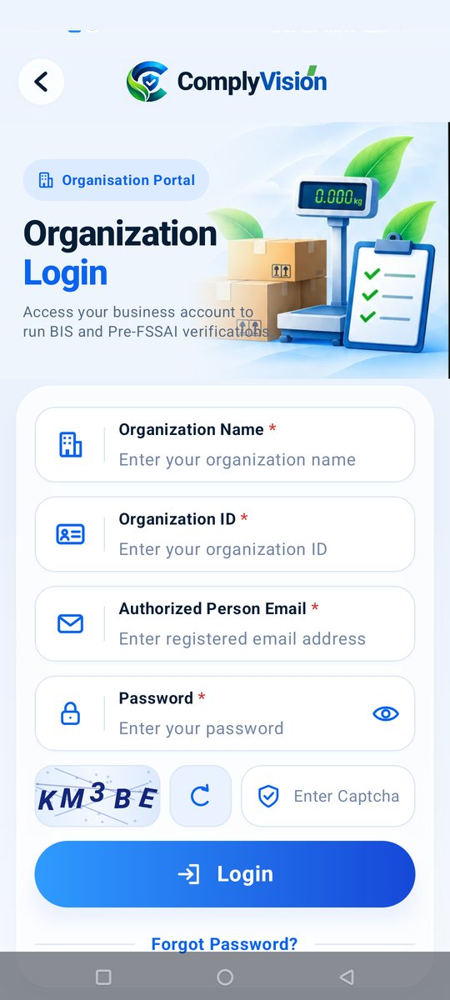 <b>Organisation login</b></td>
  </tr>
  <tr>
    <td align="center">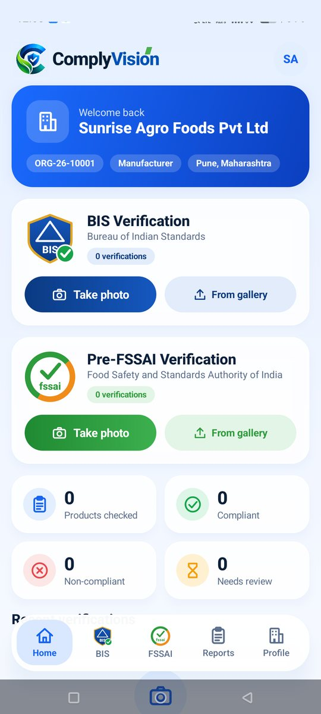 <b>Organisation home</b></td>
    <td align="center">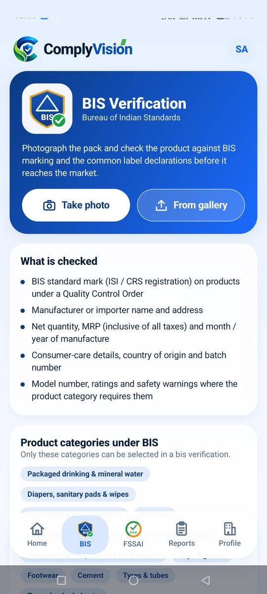 <b>BIS verification</b></td>
    <td align="center">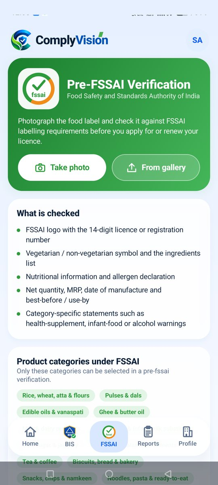 <b>Pre-FSSAI verification</b></td>
    <td align="center">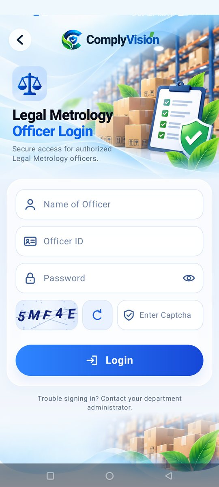 <b>Legal Metrology officer</b></td>
  </tr>
</table>

The Android app has three portals and an accessibility mode:

| Portal | For | Highlights |
| --- | --- | --- |
| **General Consumer** | Shoppers | Compliance check, every ingredient explained with a balanced health note, allergens, nutrition, expiry and shelf life, front-of-pack claims checked against the back, **Ask ComplyVision** chat, and side-by-side product comparison. Each user's scans are private. |
| **Legal Metrology** | Inspectors and the Supreme Authority | Case assignment and scheduling, field inspections with the package scanner, review of uncertain rules, dashboards, and formal PDF / JSON reports. Numeral height is measured in millimetres using an ArUco scale card. |
| **Organisation Pre-Verification** | Manufacturers, packers, importers, retailers | **BIS Verification** and **Pre-FSSAI Verification**, limited to the product categories each regulator governs, with cross-verification, missing-document checks and corrective recommendations. Organisations register on the website and log in to the app. |
| **Accessibility Mode** | Visually impaired users | Voice-guided scanning. *In progress.* |

**Multi-photo scanning.** Up to six photos of the same product (front, back, sides, documents) are analysed together
as one product.

## The web workspace

The `web` branch is a **review workspace for package-label inspection**. A reviewer provides a package image; the
analysis service validates it and runs OCR and image processing; extractors turn the text into candidate declarations
such as product identity, quantity, price, dates, manufacturer and consumer-care details, together with the text
evidence behind each one. The workspace then lets the reviewer:

- view the image with **annotation tools and evidence overlays**,
- search and filter declarations, each with a value, extraction confidence, status and rule context,
- **correct values and flag issues**, and
- export the result as JSON, CSV or a printable report.

Declarations are shown as **Passed**, **Review** or **Failed**. Confidence describes extraction evidence, not legal
certainty. The web workspace includes an Express account API for email OTP verification and a prototype
registration flow. See the [`web` branch](https://github.com/itsdhruvvarshney/complyvision-brahmashira/tree/web)
for details.

---
# The Website

  <h3>Explore the ComplyVision experience</h3>
  
<em>A visual tour of the platform's key screens</em>

<table align="center" cellspacing="18" cellpadding="0">
  <tr>
    <td align="center" valign="top">
      <h4>Public homepage &amp; product demo</h4>
      <a href="https://github.com/itsdhruvvarshney/complyvision-brahmashira/blob/web/docs/screenshots/complyvision-homepage-full.png">
        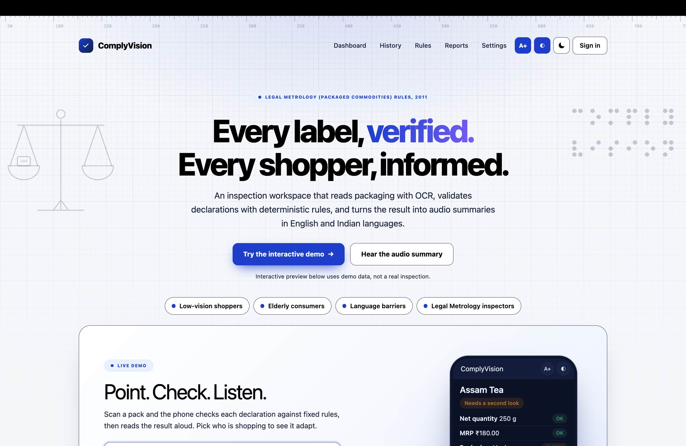
      </a>
    </td>
    <td align="center" valign="top">
      <h4>Legal Metrology sign-in</h4>
      <a href="https://github.com/itsdhruvvarshney/complyvision-brahmashira/blob/web/docs/screenshots/legal-metrology-sign-in.png">
        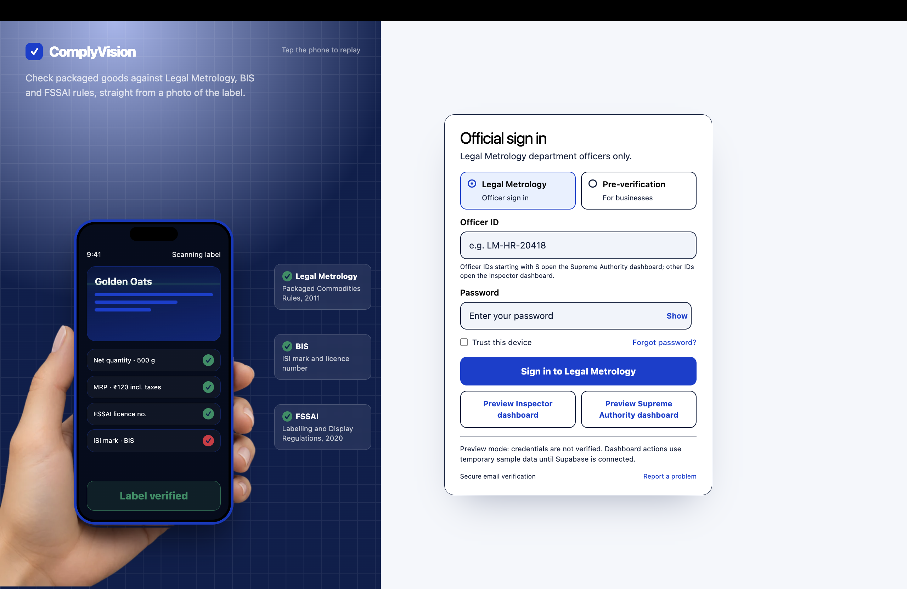
      </a>
    </td>
  </tr>
  <tr>
    <td align="center" valign="top">
      <h4>Inspection history</h4>
      <a href="https://github.com/itsdhruvvarshney/complyvision-brahmashira/blob/web/docs/screenshots/inspection-history.png">
        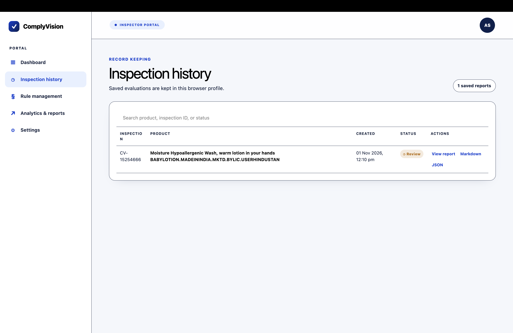
      </a>
    </td>
    <td align="center" valign="top">
      <h4>Rule management</h4>
      <a href="https://github.com/itsdhruvvarshney/complyvision-brahmashira/blob/web/docs/screenshots/rule-management.png">
        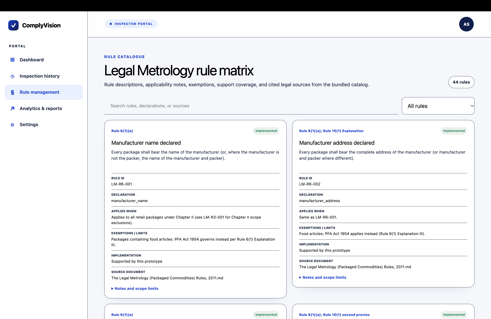
      </a>
    </td>
  </tr>
  <tr>
    <td align="center" valign="top">
      <h4>Inspection reports</h4>
      <a href="https://github.com/itsdhruvvarshney/complyvision-brahmashira/blob/web/docs/screenshots/inspection-reports.png">
        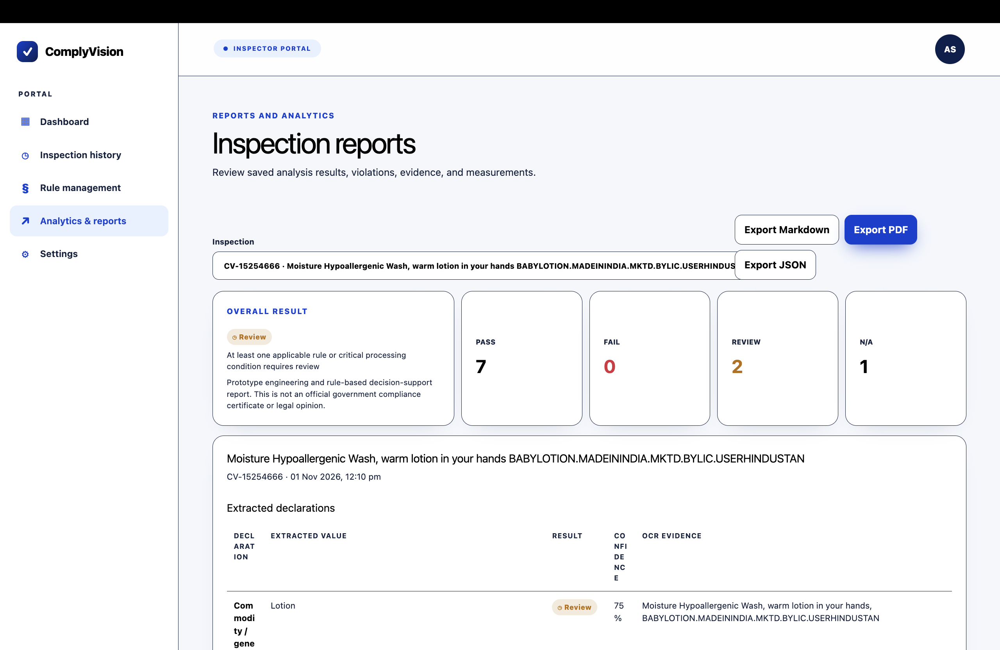
      </a>
    </td>
    <td align="center" valign="top">
      <h4>Inspector dashboard</h4>
      <a href="https://github.com/itsdhruvvarshney/complyvision-brahmashira/blob/web/docs/screenshots/inspector-dashboard.png">
        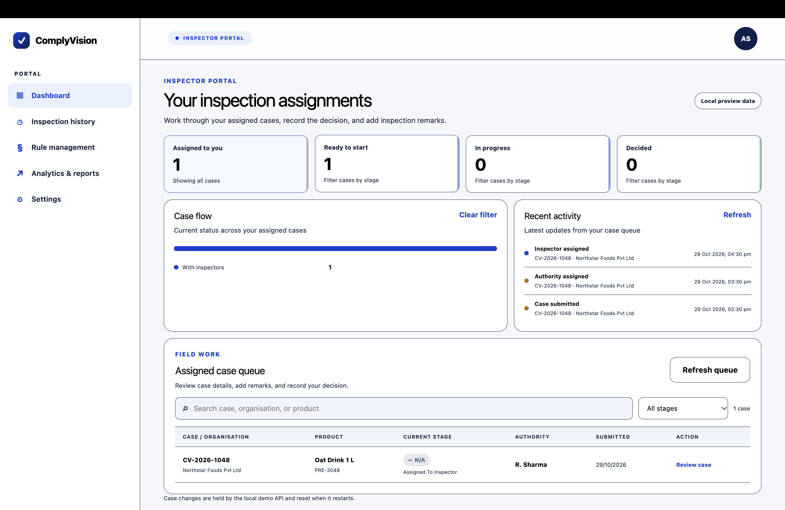
      </a>
    </td>
  </tr>
</table>

 

---
## How it works

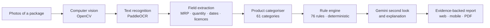

- **Categorise first, then check.** Each product is classified, then evaluated only against the rules of its
  own category, from a catalogue spanning Legal Metrology, FSS, Drugs & Cosmetics, BIS and more. Each rule carries its
  legal reference.
- **Evidence for everything.** Every result is `PASS`, `FAIL`, `REVIEW` or `NOT_APPLICABLE`, with what was expected,
  what was found, and a crop of the label that supports it.
- **The rule engine has the final word.** Gemini helps read what OCR could not and explains results, but it cannot
  override the deterministic rules for inspectors and organisations. For consumers it may confirm a declaration that
  the OCR missed, only with proof quoted from the label.
- **AI never blocks a result.** AI calls are time-boxed and spread over a pool of keys, so if the AI is slow or
  unavailable the rule-based report is still delivered.
- **Private by design.** Records live in Supabase behind Row Level Security with no direct table access; passwords are
  hashed, sessions expire, and the AI keys stay on the server.

---

## Built with

`Kotlin` · `Jetpack Compose` · `CameraX` · `React` · `FastAPI` · `PaddleOCR` · `OpenCV` · `Supabase / Postgres` ·
`Gemini` · `Express`

## Important

ComplyVision is a **decision-support tool**. It is not an official compliance certificate, legal advice or a
replacement for an inspector's decision. OCR can misread labels, so uncertain findings are flagged for human review
rather than guessed.

---

Built by Team Brahma Shira · Safer products, healthier India.

