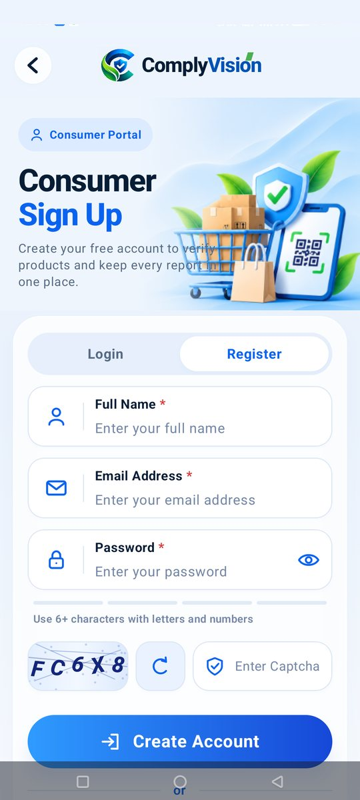
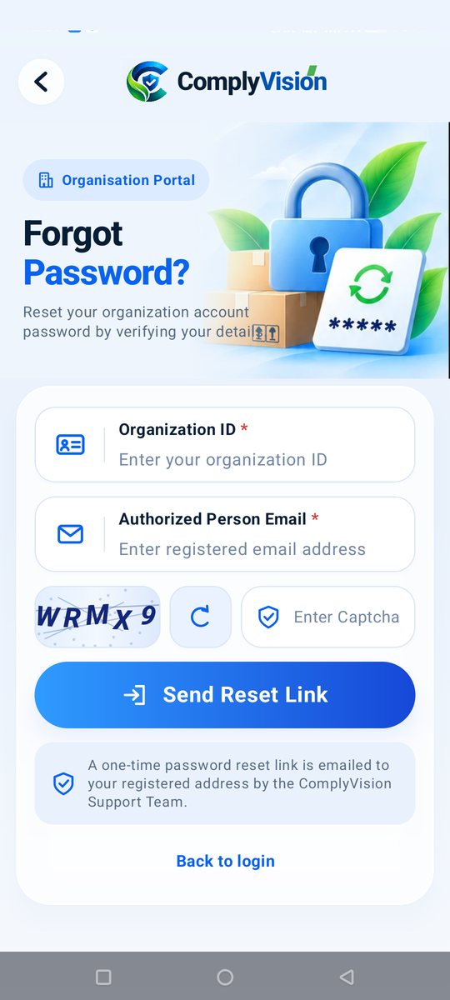
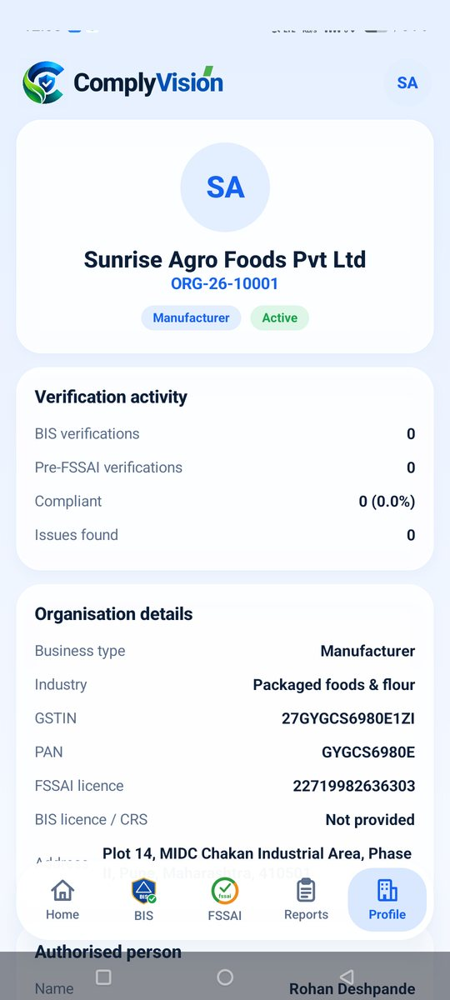
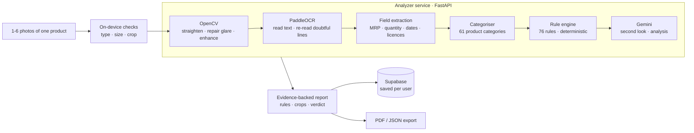

<div align="center">

# ComplyVision · Android App

**Scan a package. Understand it. Know if it is compliant.**

An AI-assisted Android app that reads product labels with OCR and computer vision, checks them against Indian
regulatory requirements (Legal Metrology, FSSAI, BIS) with a deterministic rule engine, and uses Gemini to
double-check what the machines could not read, then explains the result in plain language.

<sub>Kotlin · Jetpack Compose · CameraX · FastAPI · PaddleOCR · OpenCV · Supabase · Gemini</sub>

</div>

> **Looking for the project overview or the web workspace?** See the
> [`main` branch](https://github.com/itsdhruvvarshney/complyvision-brahmashira/tree/main) and the
> [`web` branch](https://github.com/itsdhruvvarshney/complyvision-brahmashira/tree/web).

---

## Screenshots

<table>
  <tr>
    <td align="center"><br><sub><b>Choose your mode</b></sub></td>
    <td align="center"><br><sub><b>Consumer login</b></sub></td>
    <td align="center"><br><sub><b>Consumer sign-up</b></sub></td>
    <td align="center"><br><sub><b>Business portal</b></sub></td>
  </tr>
  <tr>
    <td align="center"><br><sub><b>Legal Metrology officer login</b></sub></td>
    <td align="center"><br><sub><b>Organisation login</b></sub></td>
    <td align="center"><br><sub><b>Forgot password</b></sub></td>
    <td align="center"><br><sub><b>Organisation home</b></sub></td>
  </tr>
  <tr>
    <td align="center"><br><sub><b>BIS verification</b></sub></td>
    <td align="center"><br><sub><b>Pre-FSSAI verification</b></sub></td>
    <td align="center"><br><sub><b>Organisation profile</b></sub></td>
    <td></td>
  </tr>
</table>

---

## What the app does

Packaged goods carry a lot of small print: net quantity, MRP, dates, licence numbers, ingredients, warnings.
Checking all of it by eye is slow and error-prone. ComplyVision turns a photo (or several photos) of a pack into a
structured, evidence-backed report: every declaration it found, every rule it applied, and the exact crop of the
label that supports each finding.

The same scanning engine powers three different experiences, each with its own login and its own data.

| Portal | For | What they get |
| --- | --- | --- |
| **General Consumer** | Shoppers | Compliance check plus *product intelligence*: every ingredient explained, allergens, nutrition, expiry and shelf life, front-of-pack claims checked against the back, an **Ask ComplyVision** chat and side-by-side **product comparison**. |
| **Business · Legal Metrology** | Inspectors and the Supreme Authority | Case assignment and scheduling, field inspections with the package scanner, review and re-scoring of uncertain rules, dashboards and formal PDF reports. |
| **Business · Organisation Pre-Verification** | Manufacturers, packers, importers, retailers | **BIS Verification** and **Pre-FSSAI Verification** before a product reaches the market, restricted to the product categories each regulator actually governs, with corrective recommendations. |
| **Accessibility Mode** | Visually impaired users | Voice-guided experience (opened by tapping the card or pressing volume-up three times). *In progress.* |

---

## How a scan works



1. **Capture.** Take photos with the in-app camera (focus-on-label guide, torch, tap-to-focus) or pick them from the
   gallery. Up to six photos of the same product can be labelled front, back, side or document and analysed together.
2. **Computer vision.** OpenCV measures image quality, straightens the pack, repairs glare and low contrast.
   For inspectors, an ArUco scale card lets the app measure numeral height in millimetres. Consumers never see this step.
3. **OCR and extraction.** PaddleOCR reads the label; low-confidence lines are re-read with a larger model, and
   fields such as MRP, net quantity, dates, batch, FSSAI licence and veg/non-veg symbol are parsed.
4. **Categorise, then check.** The product is classified into one of **61 categories**, and only the rules that apply
   to that category are evaluated, from a catalogue of **76 rules** across Legal Metrology, FSS, Drugs & Cosmetics,
   BIS and more. Every result is `PASS`, `FAIL`, `REVIEW` or `NOT_APPLICABLE`, with the expected value, what was
   found, the legal reference and a cropped evidence image.
5. **AI second look.** Gemini reads all the photos together and re-checks anything the OCR could not settle.

### The rule engine always has the last word

Gemini assists, it never replaces the deterministic rule engine.

| | Consumer | Inspector and Organisation |
| --- | --- | --- |
| Gemini finds a declaration the OCR missed | The rule is turned to **AI verified · PASS**, with the quoted proof. | The engine's result stands; the rule is flagged **Check manually**. |
| Physical measurements (numeral height, contrast, image quality) | Never overridable | Never overridable |
| Anything Gemini quotes | Checked against the OCR text; an accusation needs proof printed on the label | Same |
| Overall verdict | Strictly from the rules | **Passes at 75% compliance or above**; failed rules stay listed in the report |

---

## Consumer portal highlights

- **Ingredient intelligence:** every ingredient in order, with purpose, origin (natural, synthetic, mineral, processed),
  typical uses, a balanced health note and who should be careful. Never "harmful because it is synthetic".
- **Allergens and sensitivities,** nutrition observations, and **expiry intelligence** with remaining shelf life
  calculated by the app, not guessed by the model.
- **Claims check:** front claims such as "100% natural" or "no added sugar" are compared with the back label, and a claim
  is only called misleading when the proof is quoted from the pack.
- **Label transparency:** missing or unreadable information is shown separately from confirmed problems.
- **Ask ComplyVision:** a chat that answers only from that product's scanned label and analysis.
- **Compare two products** by ingredients, nutrition, allergens and compliance.
- **Private history:** every scan is saved under the consumer's own account and can be reopened, exported or deleted.

## Business portals

**Legal Metrology.** Officer login, a Supreme Authority dashboard (inspections, inspectors, reports) and an inspector
dashboard (assigned cases, history, reports). Inspectors scan packages against a case, settle `REVIEW` rules on the
physical pack, submit findings, and export formal case or package reports as PDF or JSON.

**Organisation Pre-Verification.** Organisations register on the ComplyVision website and log in to the app with
their Organisation ID. They run *BIS* or *Pre-FSSAI* verifications on products; the category list is limited to what
each regulator governs, the report carries the regulator's name, and Gemini adds cross-verification, inconsistencies,
missing documents and corrective recommendations. Forgotten passwords are reset through a one-time link emailed by
the ComplyVision Support Team.

---

## Architecture

| Layer | Technology |
| --- | --- |
| Mobile app | Kotlin, Jetpack Compose (Material 3), CameraX, on-device PDF generation |
| Analyzer service | FastAPI, PaddleOCR, OpenCV, deterministic rule engine, Gemini |
| Backend | Supabase (Postgres): authentication, protected records, one-time reset links |
| Web registration | Static pages that call the same Supabase functions (`website/`) |

### Security by design

- Every database table has Row Level Security **with no policies** and no table grants. The app can only call
  purpose-built `SECURITY DEFINER` functions, so it cannot read or write a table directly.
- Passwords are stored as bcrypt hashes; repeated wrong logins temporarily lock the account.
- Sessions use random tokens with an expiry, and each user can only ever read their own records.
- Password-reset links are single-use, expire in 30 minutes and are stored only as hashes.
- The **Gemini API keys never leave the analyzer**. They are not in the app, the database or the reports.

### Gemini key pool

The analyzer holds a pool of Gemini keys. Each request uses a random healthy key; a key that hits its quota rests
and the request moves to another one, an invalid key is rejected, and a model that is unavailable falls back to the
next model. AI calls are time-boxed, so a slow or exhausted AI never fails a scan: the rule-based result is always
returned.

---

## Repository layout (`app` branch)

```text
app/                         Android application (Kotlin, Jetpack Compose)
  src/main/java/.../         Portals, scanner, report views, PDF export, Supabase client
analyzer/                    FastAPI analysis service
  app/                       Pipeline, OCR, vision, categoriser, rule engine, Gemini
  app/rules/                 61 categories and 76 rules with their legal references
  tests/                     Automated tests for the pipeline, rules and Gemini handling
supabase/                    SQL modules: officer, authority, inspector, rule engine,
                             consumer and organisation, plus the reset-email Edge Function
website/                     Organisation registration and password-reset pages
docs/screenshots/            Screenshots used in this README
```

---

## Status and honest limits

- ComplyVision is a **decision-support tool**. Its reports are not an official compliance certificate or legal opinion,
  and OCR can misread a label. Uncertain findings are marked for review instead of being guessed.
- The current rule catalogue has a single BIS-specific rule (the BIS mark check); BIS verification therefore leans
  on that rule plus the common label declarations. More BIS rules can be added to the catalogue.
- Accessibility Mode is still a placeholder screen.
- Organisation accounts in the demo database are fictional.

## Branches

| Branch | What it holds |
| --- | --- |
| [`main`](https://github.com/itsdhruvvarshney/complyvision-brahmashira/tree/main) | Project overview for the web and the app |
| [`web`](https://github.com/itsdhruvvarshney/complyvision-brahmashira/tree/web) | The web workspace for package-label inspection |
| [`app`](https://github.com/itsdhruvvarshney/complyvision-brahmashira/tree/app) | This Android app, the analyzer service and the Supabase modules |

<div align="center"><sub>Built by Team Brahma Shira · Safer products, healthier India.</sub></div>
